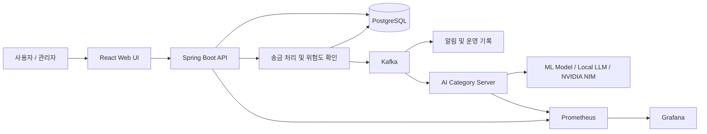
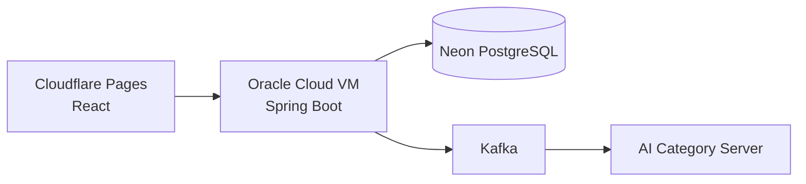

# EzPay

> 계좌 관리부터 송금, 거래 내역 확인, 알림까지 한곳에서 이용할 수 있는 간편 송금 서비스

EzPay는 사용자가 계좌를 등록하고 송금과 거래 내역을 관리할 수 있도록 만든 프로젝트입니다. 사용자 화면에서는 자산과 소비 현황을 확인할 수 있으며, 관리자 화면에서는 사용자·거래·오류·위험 거래와 서비스 상태를 관리할 수 있습니다.

송금 요청이 동시에 발생해도 잔액이 어긋나거나 같은 요청이 중복 처리되지 않도록 **계좌 잠금과 요청 식별값을 사용해 거래의 일관성을 유지**합니다. 송금 이후의 알림, 기록, 분류 작업은 메시지 기반으로 분리해 일부 기능의 지연이 전체 송금 과정에 미치는 영향을 줄였습니다.

## 주요 기능

- 회원가입, 로그인, 로그아웃과 비밀번호 재설정
- 카카오·네이버 계정을 이용한 소셜 로그인
- 계좌 등록, 조회, 삭제와 주계좌 설정
- 계좌 간 송금, 송금 취소와 처리 결과 조회
- 거래 내역 검색, 필터 저장과 월별 소비 통계
- 송금 한도 설정과 고액·반복 송금 등 위험 거래 확인
- 사용자 알림, 읽음 처리와 실시간 알림 수신
- 사용자·거래·오류·실패 이벤트를 관리하는 관리자 화면
- 거래 카테고리 자동 분류와 분류 결과 후속 처리
- 서비스 상태와 처리량을 확인하는 모니터링 환경

## 시스템 구조



### 송금 처리 흐름

1. **요청 확인**: 로그인 사용자, 출금 계좌, 수취 계좌, 금액과 송금 한도를 확인합니다.
2. **중복 방지**: 요청 식별값으로 같은 송금이 다시 처리되는 것을 방지합니다.
3. **위험도 확인**: 고액 송금, 짧은 시간의 반복 요청, 차단 계좌 여부를 규칙으로 확인합니다.
4. **잔액 변경**: 계좌를 잠근 상태에서 출금과 입금을 하나의 거래로 처리합니다.
5. **후속 처리**: 완료된 거래를 Kafka로 전달해 알림, 기록과 카테고리 분류를 이어서 처리합니다.
6. **결과 확인**: 사용자는 거래 내역과 알림을 확인하고, 관리자는 위험 거래와 실패 이벤트를 검토합니다.

송금 자체의 성공 여부와 부가 작업을 분리해 알림이나 분류 서비스에 일시적인 문제가 생겨도 핵심 거래가 불필요하게 영향을 받지 않도록 구성했습니다. 처리에 실패한 이벤트는 별도로 기록하며 관리자가 확인하고 다시 시도할 수 있습니다.

## 위험 거래 확인

| 확인 항목 | 설명 | 처리 방식 |
|---|---|---|
| 고액 송금 | 설정된 주의·위험 금액 이상인지 확인 | 점수 반영 또는 차단 |
| 반복 송금 | 짧은 시간에 송금 요청이 반복되는지 확인 | 횟수에 따라 차단 |
| 차단 계좌 | 관리 대상 계좌가 송금에 포함되는지 확인 | 즉시 차단 |
| 송금 한도 | 사용자의 일일·건별 한도를 초과하는지 확인 | 요청 거절 |
| 장애 격리 | 위험도 확인 기능에 연속 오류가 발생하는지 확인 | 일시적으로 호출 제한 |

판단 기준은 환경변수로 조정할 수 있으며, 보류되거나 차단된 거래는 관리자 화면에서 확인할 수 있습니다.

## 거래 카테고리 분류

AI Category Server는 거래 정보를 받아 카테고리를 분류하는 Python 기반 서비스입니다.

- 학습된 분류 모델을 먼저 사용해 빠르게 결과를 생성합니다.
- 신뢰도가 낮은 경우 설정에 따라 LLM 분석으로 전환할 수 있습니다.
- 로컬 LM Studio와 NVIDIA NIM을 지원합니다.
- 제공자 호출 실패 시 재시도하고 설정된 대체 제공자로 전환합니다.
- Kafka를 통해 분류 요청과 완료 이벤트를 비동기로 처리합니다.
- 모델 학습 결과와 실험 정보는 MLflow에서 관리할 수 있습니다.

외부 AI 서비스가 설정되지 않아도 기본 분류 기능과 송금 서비스는 독립적으로 실행할 수 있습니다.

## 기술 스택

| 영역 | 기술 |
|---|---|
| Backend | Java 17, Spring Boot 3.4, Spring Security, Spring Data JPA, QueryDSL |
| Frontend | React 18, TypeScript, Vite, Tailwind CSS, Recharts |
| AI Server | Python, FastAPI, scikit-learn, Pydantic, MLflow |
| Database | PostgreSQL, H2 |
| Messaging | Apache Kafka |
| Monitoring | Spring Actuator, Micrometer, Prometheus, Grafana |
| Infrastructure | Docker, Docker Compose, Nginx |

## 저장소 구성

```text
EzPay/
├── backend/                    # 인증, 계좌, 송금, 알림과 관리자 API
├── frontend/                   # 사용자 및 관리자 웹 화면
├── ai-category-server/         # 거래 카테고리 분류와 Kafka 연동
├── monitoring/                 # Prometheus·Grafana 설정
├── docker-compose.yml          # 애플리케이션 실행 환경
├── docker-compose-monitoring.yml
├── start.sh                    # 전체 서비스 실행
└── stop.sh                     # 전체 서비스 종료
```

## 주요 화면

- **대시보드**: 총자산, 월별 지출, 최근 거래와 자주 송금한 사용자 확인
- **계좌**: 계좌 등록, 상세 조회, 삭제와 주계좌 변경
- **송금**: 수취인과 금액 입력, 송금 결과 확인
- **거래 내역**: 조건별 검색, 필터 저장과 상세 내역 조회
- **통계**: 기간·카테고리별 지출 현황 확인
- **알림**: 송금과 서비스 알림 조회 및 읽음 처리
- **관리자**: 사용자, 거래, 송금 한도, 위험 거래와 실패 이벤트 관리
- **운영 화면**: 시스템 로그, 오류, 처리량과 거래 처리 단계 확인

## 빠른 실행

### 사전 준비

- Docker Desktop 및 Docker Compose
- PostgreSQL 데이터베이스
- 컨테이너를 사용하지 않는 경우 Java 17, Node.js 18 이상과 Python 3

### 환경 파일 준비

비밀값을 포함하는 환경 파일은 저장소에서 제외됩니다. 실행 전에 다음 파일을 직접 생성합니다.

`backend/.env`

```env
SPRING_DATASOURCE_URL=jdbc:postgresql://host.docker.internal:5432/ezpay
SPRING_DATASOURCE_USERNAME=postgres
SPRING_DATASOURCE_PASSWORD=your-password
SPRING_PROFILES_ACTIVE=local
SPRING_KAFKA_BOOTSTRAP_SERVERS=kafka:9092
SMTP_USERNAME=your-email@gmail.com
SMTP_PASSWORD=your-app-password
FRONTEND_BASE_URL=http://localhost:3000
```

`frontend/.env`

```env
VITE_API_BASE_URL=http://localhost:8081
```

`ai-category-server/config/.env`

```env
KAFKA_ENABLED=true
KAFKA_BOOTSTRAP_SERVERS=kafka:9092
AI_PRIMARY_PROVIDER=local
AI_FALLBACK_ENABLED=false
LM_STUDIO_BASE_URL=http://host.docker.internal:1234/v1
LM_STUDIO_MODEL=local-model
```

### 전체 서비스 실행

저장소 루트에서 다음 명령을 실행합니다.

```bash
./start.sh
```

| 서비스 | 주소 |
|---|---|
| Web UI | http://localhost:3000 |
| Backend API | http://localhost:8081 |
| AI Category API | http://localhost:8000 |
| MLflow | http://localhost:5001 |
| Prometheus | http://localhost:9090 |
| Grafana | http://localhost:3001 |

서비스를 종료할 때는 다음 명령을 사용합니다.

```bash
./stop.sh
```

데이터 볼륨까지 함께 삭제하려면 `./stop.sh -v`를 사용합니다. 이 명령은 Kafka, MLflow와 모니터링 데이터를 복구할 수 없게 삭제하므로 주의해야 합니다.

## 환경 설정

주요 설정은 코드에 저장하지 않고 환경변수로 주입합니다.

| 변수 | 설명 | 기본값 |
|---|---|---|
| `SPRING_DATASOURCE_URL` | PostgreSQL 연결 주소 | 로컬 PostgreSQL |
| `SPRING_DATASOURCE_USERNAME` | 데이터베이스 사용자 | `postgres` |
| `SPRING_DATASOURCE_PASSWORD` | 데이터베이스 비밀번호 | 로컬 개발값 |
| `SPRING_KAFKA_BOOTSTRAP_SERVERS` | Kafka 연결 주소 | `localhost:9092` |
| `SMTP_USERNAME` | 비밀번호 재설정 메일 발신 계정 | 필수 |
| `SMTP_PASSWORD` | 메일 계정 비밀번호 | 필수 |
| `KAKAO_CLIENT_ID` | 카카오 로그인 클라이언트 ID | 미설정 |
| `NAVER_CLIENT_ID` | 네이버 로그인 클라이언트 ID | 미설정 |
| `EZPAY_FDS_BLOCK_SCORE` | 위험 거래 차단 점수 | `80` |
| `EZPAY_FDS_REVIEW_SCORE` | 관리자 검토 점수 | `40` |
| `NVIDIA_API_KEY` | NVIDIA NIM 인증 키 | 미설정 |
| `SENTRY_DSN` | 오류 수집 서비스 연결 주소 | 미설정 |

## 주요 API

| 영역 | 경로 | 설명 |
|---|---|---|
| 인증 | `POST /users/signup` | 회원가입 |
| 인증 | `POST /users/login` | 로그인 및 토큰 발급 |
| 인증 | `POST /users/oauth/{provider}/login` | 소셜 로그인 |
| 계좌 | `GET /account/me` | 내 계좌 조회 |
| 계좌 | `POST /account` | 계좌 등록 |
| 송금 | `POST /transaction/transfer` | 송금 요청 |
| 송금 | `GET /transaction/transfer/{requestId}` | 송금 처리 결과 조회 |
| 거래 | `GET /transaction/account/{accountId}` | 계좌별 거래 내역 조회 |
| 통계 | `GET /api/statistics/spending-summary` | 소비 요약 조회 |
| 알림 | `GET /user-notifications` | 내 알림 조회 |
| 알림 | `GET /user-notifications/stream` | 실시간 알림 연결 |
| 관리자 | `GET /admin/dashboard` | 관리자 대시보드 조회 |
| 관리자 | `GET /admin/risk-transactions` | 위험 거래 조회 |
| 관리자 | `POST /admin/failed-events/{id}/retry` | 실패 이벤트 재처리 |

## 개별 실행 및 테스트

### Backend

```bash
cd backend
./gradlew bootRun
./gradlew test
```

백엔드 테스트에는 송금 동시성, 계좌 잠금, 사용자 권한, 비밀번호 재설정, 위험 거래와 Kafka 실패 이벤트 처리가 포함됩니다. PostgreSQL 기반 테스트에는 Docker가 필요합니다.

### Frontend

```bash
cd frontend
npm ci
npm run start
npm run lint
npm run build
npm run test:e2e
```

### AI Category Server

```bash
cd ai-category-server
python3 -m venv .venv
source .venv/bin/activate
pip install -r requirements.txt
uvicorn app.main:app --host 0.0.0.0 --port 8000
```

## 무료 배포 구성

여러 개의 서버와 Kafka를 사용하는 현재 구성을 일반적인 무료 웹 호스팅 한 곳에 모두 올리기는 어렵습니다. 다음처럼 역할을 나누면 별도의 월 사용료 없이 배포할 수 있습니다.

| 영역 | 서비스 | 역할 |
|---|---|---|
| Frontend | [Cloudflare Pages](https://pages.cloudflare.com/) | React 정적 파일 배포와 HTTPS 제공 |
| Backend | [Oracle Cloud Free Tier](https://www.oracle.com/cloud/free/) | Spring Boot, Kafka, AI Category Server 실행 |
| Database | [Neon Free Plan](https://neon.com/pricing) | PostgreSQL 데이터 저장 |



### 1. 데이터베이스

Neon에서 무료 PostgreSQL 프로젝트를 만들고 발급된 연결 정보를 Oracle VM의 `backend/.env`에 등록합니다.

```env
SPRING_DATASOURCE_URL=jdbc:postgresql://<NEON_HOST>/<DATABASE>?sslmode=require
SPRING_DATASOURCE_USERNAME=<NEON_USER>
SPRING_DATASOURCE_PASSWORD=<NEON_PASSWORD>
SPRING_PROFILES_ACTIVE=prod
```

### 2. 백엔드와 부가 서비스

Oracle Cloud의 Always Free Ampere A1 VM에 Docker와 Git을 설치한 뒤 저장소를 내려받습니다. 환경 파일을 준비하고 필요한 서비스만 실행합니다.

```bash
git clone https://github.com/bitofsyn/EzPay.git
cd EzPay
docker compose up -d --build backend kafka zookeeper ai-category
```

메모리를 절약하려면 MLflow, Prometheus와 Grafana는 배포 대상에서 제외하고 필요할 때만 실행합니다. Ampere A1은 ARM 기반이므로 Docker 이미지가 실행되지 않을 경우 ARM64를 지원하는 이미지로 변경하거나 해당 서비스를 VM에서 직접 빌드해야 합니다.

백엔드 API는 무료 도메인 또는 보유한 도메인에 연결하고 Caddy나 Nginx로 HTTPS를 적용합니다. Oracle Cloud 보안 목록에서는 외부에 공개할 HTTP·HTTPS 포트만 허용합니다.

### 3. 프런트엔드

Cloudflare Pages에서 GitHub 저장소를 연결하고 다음 빌드 설정을 사용합니다.

| 항목 | 값 |
|---|---|
| Root directory | `frontend` |
| Build command | `npm ci && npm run build` |
| Build output directory | `dist` |
| Environment variable | `VITE_API_BASE_URL=https://<BACKEND_DOMAIN>` |

배포가 끝나면 Cloudflare가 제공하는 `pages.dev` 주소에서 서비스를 확인할 수 있습니다. 백엔드의 `CORS_ALLOWED_ORIGINS`에는 발급된 Pages 주소를 등록해야 합니다.

Oracle Always Free 자원은 리전별로 생성 가능한 수량이 다르고 오래 사용하지 않는 인스턴스가 회수될 수 있습니다. 무료 정책과 제공량은 계정 생성 전에 각 서비스의 공식 안내에서 다시 확인해야 합니다.
