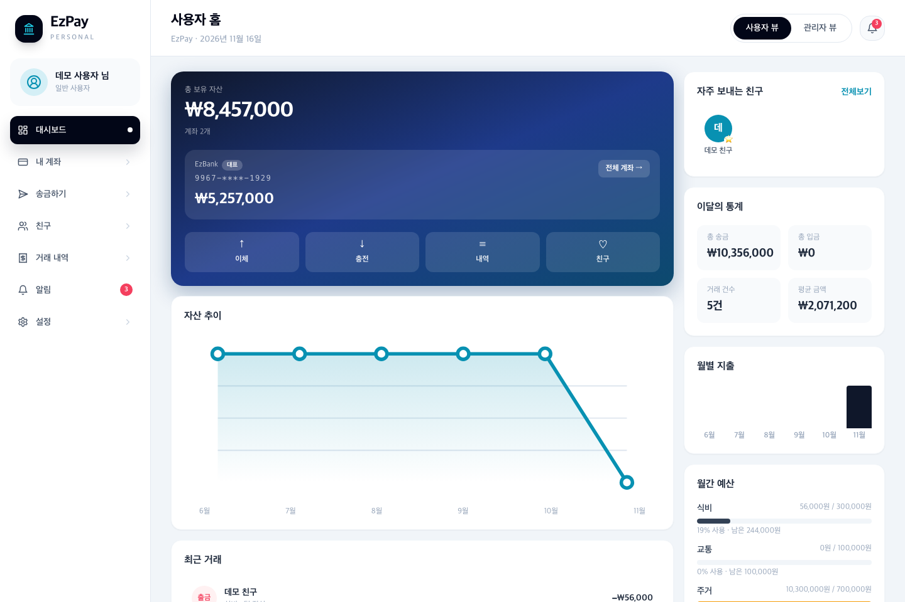
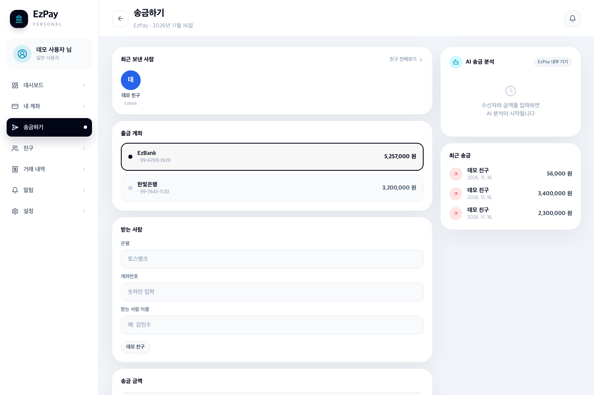
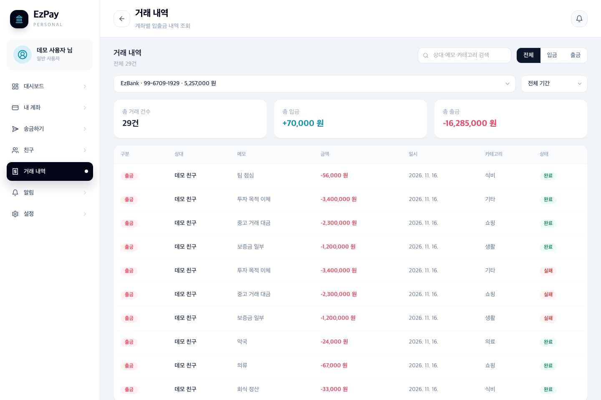
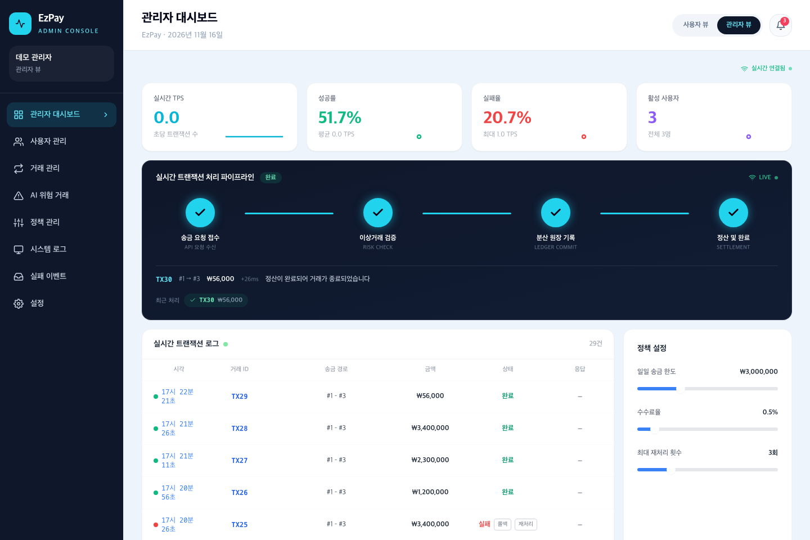
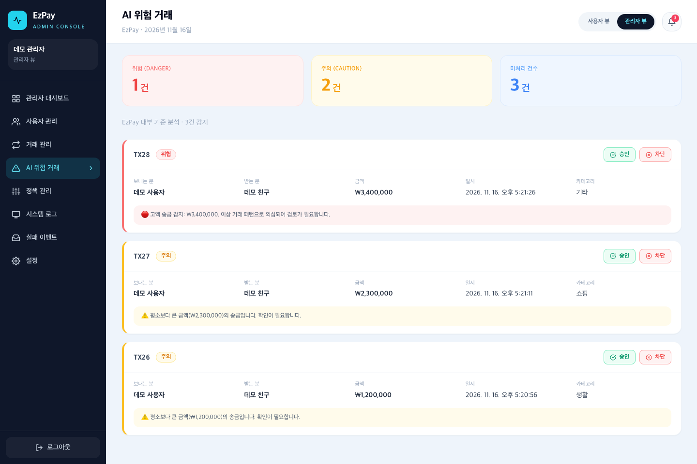
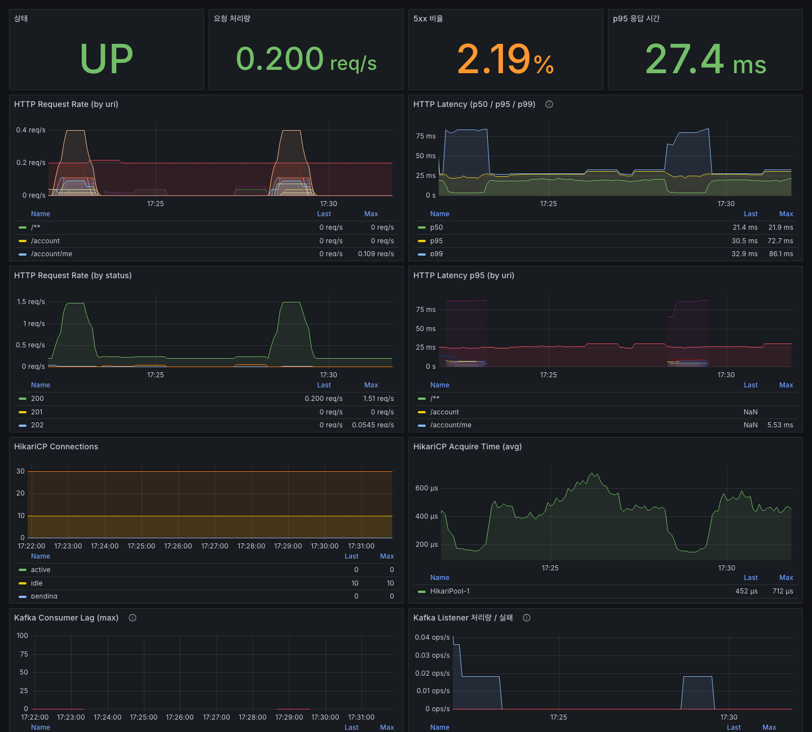
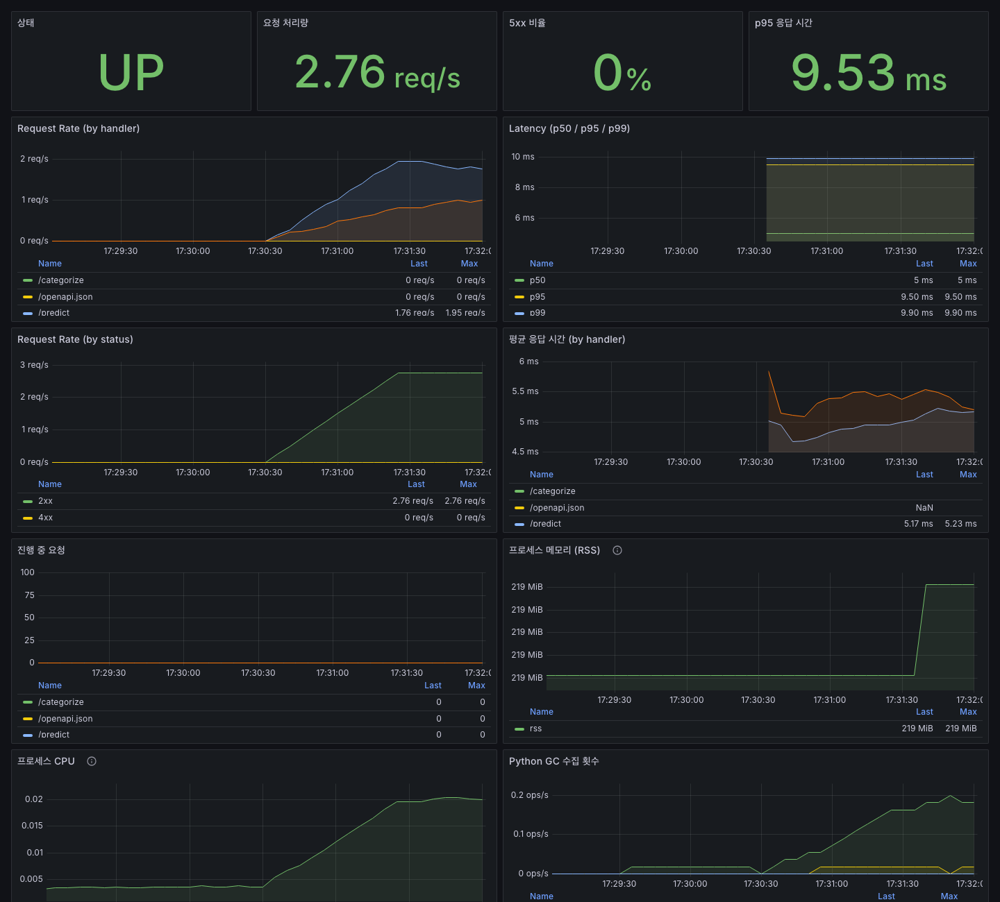
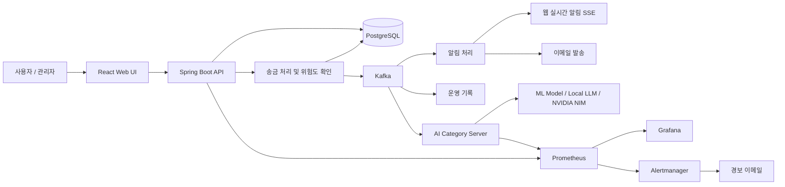

# EzPay

[](https://github.com/bitofsyn/EzPay/actions/workflows/ci.yml)
[](https://github.com/bitofsyn/EzPay/actions/workflows/cd.yml)

> 계좌 관리부터 송금, 거래 내역 확인, 알림까지 한곳에서 이용할 수 있는 간편 송금 서비스

EzPay는 사용자가 계좌를 등록하고 송금과 거래 내역을 관리할 수 있도록 만든 프로젝트입니다. 사용자 화면에서는 자산과 소비 현황을 확인할 수 있으며, 관리자 화면에서는 사용자·거래·오류·위험 거래와 서비스 상태를 관리할 수 있습니다.

송금 요청이 동시에 발생해도 잔액이 어긋나거나 같은 요청이 중복 처리되지 않도록 **계좌 잠금과 요청 식별값을 사용해 거래의 일관성을 유지**합니다. 송금 이후의 알림, 기록, 분류 작업은 메시지 기반으로 분리해 일부 기능의 지연이 전체 송금 과정에 미치는 영향을 줄였습니다.

## 배포 주소

- **Web UI**: [https://ezpay.devfolio-2026.workers.dev/](https://ezpay.devfolio-2026.workers.dev/)
- **Backend 상태 확인**: [https://ezpay-82sw.onrender.com/health](https://ezpay-82sw.onrender.com/health)

프런트엔드는 Cloudflare Workers, 백엔드는 Render에 배포되어 있습니다. Render 무료 인스턴스는 일정 시간 요청이 없으면 중지되므로 첫 접속 시 응답까지 시간이 걸릴 수 있습니다.

## 주요 기능

- 회원가입·로그인, 카카오·네이버 소셜 로그인, 비밀번호 재설정
- 계좌 등록과 계좌 간 송금, 거래 내역 검색과 월별 소비 통계
- 송금 한도 설정과 고액·반복 송금 등 위험 거래 확인
- 웹·이메일 알림과 거래 카테고리 자동 분류
- 사용자·거래·위험 거래·실패 이벤트를 관리하는 관리자 화면
- Prometheus·Grafana 모니터링과 이메일 경보

## 화면

### 사용자



*총자산, 이달의 송금·입금 통계, 월별 지출과 자산 추이, 자주 보내는 친구, 카테고리별 월간 예산을 한 화면에서 확인합니다.*

| 송금 | 거래 내역 |
|---|---|
|  |  |
| 출금 계좌와 수취인을 고르고 금액을 입력합니다. 최근 보낸 사람과 AI 송금 분석을 함께 보여줍니다. | 계좌별 입출금 내역을 상태·카테고리와 함께 조회하고 기간·유형으로 필터링합니다. |

### 관리자

| 실시간 트랜잭션 파이프라인 | 위험 거래 검토 |
|---|---|
|  |  |
| 송금 요청이 접수·위험 검증·원장 기록·정산을 거치는 과정을 SSE로 실시간 표시하고, TPS와 성공·실패율을 보여줍니다. | 고액·반복 송금을 위험·주의 등급으로 분류해 관리자가 승인 또는 차단합니다. |

### 모니터링

| 백엔드 | AI Category Server |
|---|---|
|  |  |
| 처리량·5xx 비율·응답 시간, HikariCP 커넥션, Kafka 컨슈머 lag | 핸들러별 요청률·지연 시간, 상태 코드별 처리량, 메모리·CPU |

> 위 화면은 로컬에서 만든 데모 계정과 샘플 데이터로 캡처했습니다.

## 시스템 구조



현재 공개된 서비스는 Cloudflare Workers(React), Render(Spring Boot), AWS RDS(PostgreSQL)로 구성되어 있고, Kafka·AI Category Server·모니터링은 로컬 또는 별도 환경에서 실행합니다. 송금 처리 흐름과 위험도 확인 방식은 [시스템 구조 문서](docs/architecture.md)에 정리했습니다.

## 송금 처리량

부하테스트로 송금 파이프라인의 병목(단일 파티션·단일 컨슈머, 계좌 락 보유 중 SMTP 동기 발송)을 찾아 개선했습니다. 같은 조건에서 개선 전후 end-to-end 처리량을 비교한 결과입니다.

| 조건 | 개선 전 | 개선 후 |
|---|---|---|
| DB 왕복 +5ms (운영 RDS 수준) | 6.1 TPS | **33.7 TPS** (5.5배) |
| 로컬 DB | 151 TPS | **541 TPS** (3.6배) |
| 송금 메일 알림 ON | 1.0 TPS | **20 TPS 이상** (제출률 그대로 처리) |

모든 실행에서 처리 성공률 100%, 잔액 합 보존, 음수 잔액 0건이었습니다. 측정 방법과 한계는 [송금 처리량 개선](docs/performance.md)에 있습니다.

## 기술 스택

| 영역 | 기술 |
|---|---|
| Backend | Java 17, Spring Boot 3.4, Spring Security, Spring Data JPA, QueryDSL |
| Frontend | React 18, TypeScript, Vite, Tailwind CSS, Recharts |
| AI Server | Python, FastAPI, scikit-learn, Pydantic, MLflow |
| Database | PostgreSQL, H2, Flyway |
| Messaging | Apache Kafka |
| Monitoring | Spring Actuator, Micrometer, Prometheus, Alertmanager, Grafana |
| Infrastructure | Docker, Docker Compose, Nginx |

## 빠른 시작

Docker Desktop이 필요합니다. 먼저 `backend/.env`, `frontend/.env`, `ai-category-server/config/.env`를 준비하고([환경 파일 예시](docs/operations.md#환경-파일-준비)) 저장소 루트에서 실행합니다.

```bash
./start.sh   # 전체 서비스 실행
./stop.sh    # 종료
```

| 서비스 | 로컬 주소 |
|---|---|
| Web UI | http://localhost:3000 |
| Backend API | http://localhost:8081 |
| AI Category API | http://localhost:8000 |
| Prometheus · Alertmanager | http://localhost:9090 · http://localhost:9093 |
| Grafana | http://localhost:3001 |

## 문서

| 문서 | 내용 |
|---|---|
| [시스템 구조](docs/architecture.md) | 배포 구조, 송금 처리 흐름, 알림, 위험 거래 확인, 카테고리 분류 |
| [송금 처리량 개선](docs/performance.md) | 부하테스트로 찾은 병목과 개선 전/후 수치 (6.1 → 33.7 TPS 등), 재현 방법 |
| [모니터링](docs/monitoring.md) | Prometheus·Grafana 대시보드, 경보 규칙, 이메일 알림 설정 |
| [실행·배포·테스트](docs/operations.md) | 환경 파일과 환경변수, CI/CD, Jenkins, 개별 실행과 테스트 |
| [주요 API](docs/api.md) | 인증·계좌·송금·알림·관리자 API 목록 |
| [Flyway](docs/Flyway.md) | 데이터베이스 마이그레이션 |
