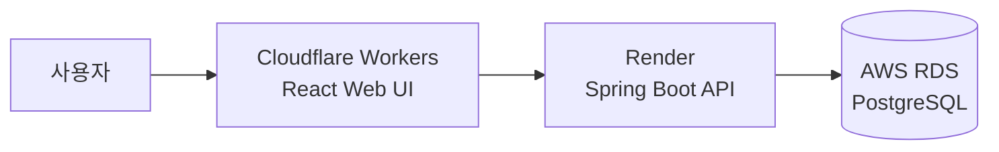
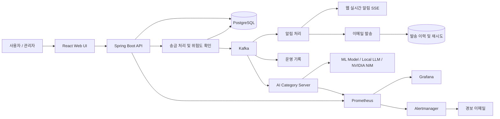
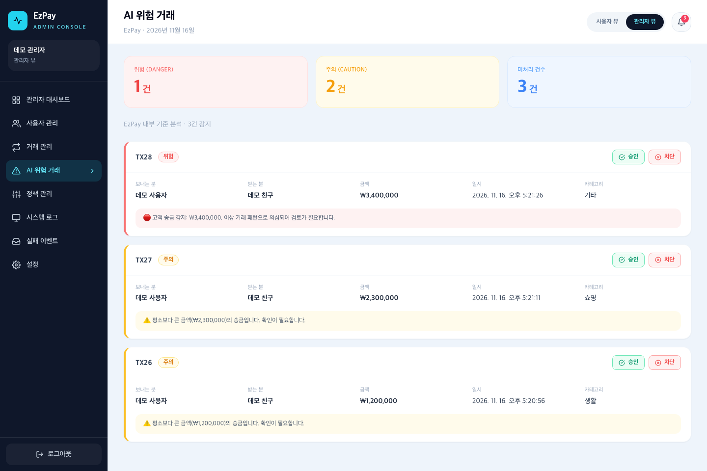

# 시스템 구조

## 현재 배포 구조

현재 공개된 서비스는 프런트엔드, 백엔드와 데이터베이스로 구성되어 있습니다.

## 전체 구성

Kafka, AI Category Server와 모니터링 도구를 포함한 전체 구성은 로컬 개발 또는 별도의 실행 환경에서 사용할 수 있습니다.

## 송금 처리 흐름

1. **요청 확인**: 로그인 사용자, 출금 계좌, 수취 계좌, 금액과 송금 한도를 확인합니다.
2. **중복 방지**: 요청 식별값으로 같은 송금이 다시 처리되는 것을 방지합니다.
3. **위험도 확인**: 고액 송금, 짧은 시간의 반복 요청, 차단 계좌 여부를 규칙으로 확인합니다.
4. **잔액 변경**: 계좌를 잠근 상태에서 출금과 입금을 하나의 거래로 처리합니다.
5. **후속 처리**: 완료된 거래를 Kafka로 전달해 알림, 기록과 카테고리 분류를 이어서 처리합니다.
6. **결과 확인**: 사용자는 거래 내역과 알림을 확인하고, 관리자는 위험 거래와 실패 이벤트를 검토합니다.

송금 이벤트는 출금 계좌 ID를 키로 6개 파티션에 나뉘고 컨슈머 6개가 병렬로 처리합니다. 같은 계좌의 송금은 요청 순서대로, 서로 다른 계좌 쌍은 계좌 락으로 정합성을 지키며 동시에 처리됩니다([처리량 측정](performance.md)).

송금 자체의 성공 여부와 부가 작업을 분리해 알림이나 분류 서비스에 일시적인 문제가 생겨도 핵심 거래가 불필요하게 영향을 받지 않도록 구성했습니다. 처리에 실패한 이벤트는 별도로 기록하며 관리자가 확인하고 다시 시도할 수 있습니다.

## 알림 처리

- 송금 완료와 입금 내역은 웹 알림으로 저장하고 SSE를 통해 실시간 전달합니다.
- 이메일 알림을 활성화한 사용자는 송금 완료 메일을 받을 수 있습니다.
- 이메일은 발송 이력만 먼저 기록하고, 커밋 후 별도 스레드 풀에서 보냅니다. 송금 처리가 SMTP 응답을 기다리지 않습니다.
- 이메일 발송 결과는 `PENDING`, `RETRYING`, `SENT`, `FAILED` 상태로 기록합니다.
- 일시적인 SMTP 장애는 설정된 횟수까지 자동으로 재시도하며, 최종 실패 원인을 운영 기록으로 남깁니다.
- 위험 거래가 감지되면 설정된 관리자 이메일로 거래 정보와 감지 사유를 전달합니다.

## 위험 거래 확인

| 확인 항목 | 설명 | 처리 방식 |
|---|---|---|
| 고액 송금 | 설정된 주의·위험 금액 이상인지 확인 | 점수 반영 또는 차단 |
| 반복 송금 | 짧은 시간에 송금 요청이 반복되는지 확인 | 횟수에 따라 차단 |
| 차단 계좌 | 관리 대상 계좌가 송금에 포함되는지 확인 | 즉시 차단 |
| 송금 한도 | 사용자의 일일·건별 한도를 초과하는지 확인 | 요청 거절 |
| 장애 격리 | 위험도 확인 기능에 연속 오류가 발생하는지 확인 | 일시적으로 호출 제한 |

판단 기준은 환경변수로 조정할 수 있으며, 보류되거나 차단된 거래는 관리자 화면에서 확인할 수 있습니다.

*검토가 필요한 고액 송금을 위험·주의 등급으로 분류하고, 관리자가 승인 또는 차단합니다.*

## 거래 카테고리 분류

AI Category Server는 거래 정보를 받아 카테고리를 분류하는 Python 기반 서비스입니다.

- 학습된 분류 모델을 먼저 사용해 빠르게 결과를 생성합니다.
- 신뢰도가 낮은 경우 설정에 따라 LLM 분석으로 전환할 수 있습니다.
- 로컬 LM Studio와 NVIDIA NIM을 지원합니다.
- 제공자 호출 실패 시 재시도하고 설정된 대체 제공자로 전환합니다.
- Kafka를 통해 분류 요청과 완료 이벤트를 비동기로 처리합니다.
- 모델 학습 결과와 실험 정보는 MLflow에서 관리할 수 있습니다.

외부 AI 서비스가 설정되지 않아도 기본 분류 기능과 송금 서비스는 독립적으로 실행할 수 있습니다.
