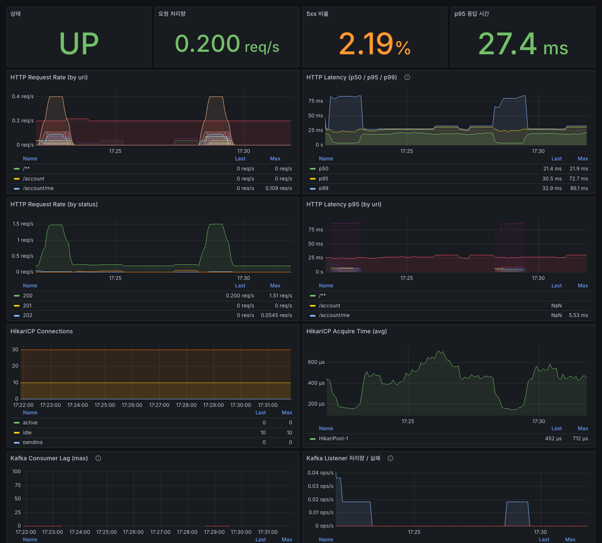
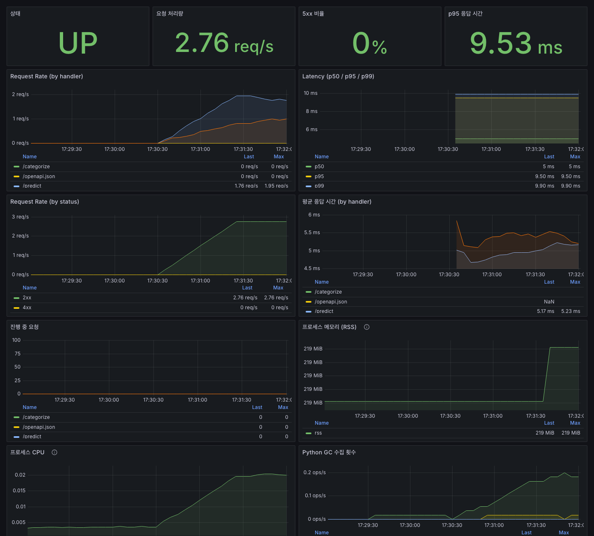

# 모니터링

Prometheus, Alertmanager, Grafana는 `docker-compose-monitoring.yml`로 실행되며 로컬 루프백(127.0.0.1)에만 게시됩니다. `./start.sh`로 앱 스택과 함께 기동됩니다.

| 항목 | 위치 |
|---|---|
| 수집 대상 | Backend `/actuator/prometheus`, AI Category `/metrics` ([prometheus.yml](../monitoring/prometheus/prometheus.yml)) |
| 경보 규칙 | [ezpay-alerts.yml](../monitoring/prometheus/rules/ezpay-alerts.yml) — 발화 상태는 http://localhost:9090/alerts 에서 확인 |
| 경보 알림 | Alertmanager(http://localhost:9093)가 이메일로 발송 ([entrypoint.sh](../monitoring/alertmanager/entrypoint.sh)) |
| 대시보드 | Grafana(http://localhost:3001) `EzPay` 폴더 ([dashboards](../monitoring/grafana/dashboards)) |

## 대시보드

*Spring Boot 백엔드: 상태·처리량·5xx 비율·p95 응답 시간, HTTP 지연, HikariCP 커넥션, Kafka 컨슈머 lag과 리스너 처리량.*

*AI Category Server: 핸들러별 요청률과 지연 시간, 상태 코드별 처리량, 프로세스 메모리·CPU.*

## 경보

| 경보 | 조건 |
|---|---|
| `TargetDown` | 스크레이프 대상이 1분 이상 응답하지 않음 |
| `BackendHighErrorRate` | 백엔드 5xx 비율이 5분간 5% 초과 |
| `BackendHighLatencyP95` | 백엔드 p95 응답 시간이 5분간 1초 초과 (SSE 스트림 제외) |
| `HikariPoolExhausted` | DB 커넥션을 기다리는 스레드가 1분 이상 존재 |
| `JvmHeapUsageHigh` | JVM 힙 사용률이 5분간 90% 초과 |
| `KafkaConsumerLagHigh` | Kafka 컨슈머 lag이 2분간 1000건 초과 |
| `AiCategoryHighErrorRate` | AI 서버 5xx 비율이 5분간 5% 초과 |

## 설정

- Grafana 기본 계정은 `admin` / `admin`이며 `GRAFANA_ADMIN_PASSWORD` 환경변수로 변경합니다. 비밀번호는 `grafana-data` 볼륨을 처음 만들 때만 적용됩니다.
- Backend는 기본적으로 `health`, `info`만 노출합니다(Render 공개 배포 기준). `prometheus` 엔드포인트는 `MANAGEMENT_ENDPOINTS_INCLUDE=health,info,prometheus`를 준 환경에서만 열리며, `docker-compose.yml`과 `local` 프로파일에는 이미 설정되어 있습니다.
- 경보 메일은 `start.sh`가 `backend/.env`의 `SMTP_USERNAME`/`SMTP_PASSWORD`를 재사용해 발송합니다. 수신 주소는 `ALERT_EMAIL_TO` → `ADMIN_ALERT_EMAIL` → `SMTP_USERNAME` 순으로 정해지며, SMTP 값이 없으면 알림 없이 기동합니다.
- 같은 경보는 4시간마다 재알림하고, 서비스 다운(`TargetDown`) 시 같은 job의 warning 경보는 억제합니다.
- Kafka 지표(`kafka_consumer_*`, `spring_kafka_listener_*`)는 `EZPAY_KAFKA_ENABLED=true`일 때만 수집됩니다.
- 규칙 문법 검증: `promtool check rules monitoring/prometheus/rules/ezpay-alerts.yml`
